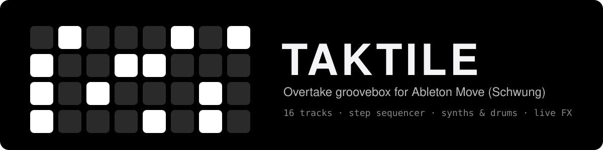
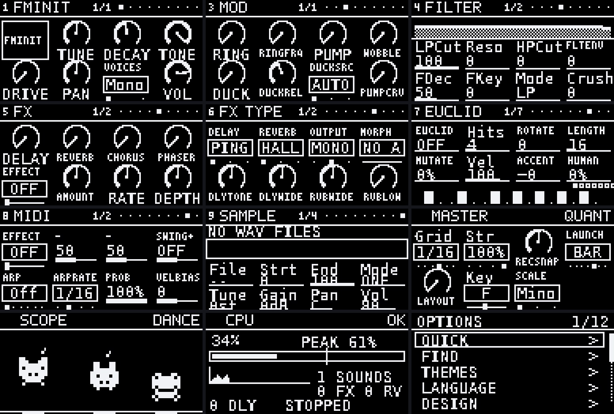
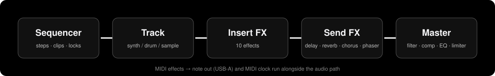

<p align="center">
  
</p>

<p align="center">
  
  
  
  
  
</p>

<p align="center"><b>16 tracks of synths and drums, a step sequencer, sounds, effects and live performance tools – all running as a Schwung overtake module on the Ableton Move.</b></p>

> [!NOTE]
> **Status:** Developed and tested together with a real Ableton Move. Release 5.93.0 itself was checked on a desktop (UI simulator, 60,000-event fuzzing, native builds); please report anything that behaves differently on the device.

---

## What is Taktile?

Taktile is a pattern-based groove box built for jamming live. It takes over the Move's pads, buttons, knobs and display. All sound comes from its own C DSP (`dsp.so`), so you get a complete instrument rather than a controller for something else.

## On the display

<p align="center">
  
</p>

<p align="center"><sub>Display pages rendered on a desktop (simulator): sound, filter, mod, FX, master bus, master EQ, kit, step parameters and options.</sub></p>

## Features

| | |
|---|---|
| 🎹 **Tracks** | 16 tracks, synth or drum (16 sounds per drum track), up to 128 steps, 8 clips per track, song chain |
| 🔊 **Sounds** | 1462 built-in sounds, your own WAV samples (64 slots / 40 MB) on drum tracks, slicing, kits from 16 WAVs, time-stretch, resampling |
| 🗂️ **Track tiles** | Synth track: 1 PRESET · 2 SYNTH · 3 MOD · 4 FILTER (+ EQ) · 5 FX (+ GRAIN) · 6 FX TYPE (+ FX TIME) · 7 EUCLID · 8 MIDI FX. Drum tracks have no SYNTH tile but a SAMPLE tile. The header shows the tile top left and the page (e.g. 2/2) top right; jog click switches the page |
| 🎛️ **Effects** | Per-track delay, reverb, chorus, phaser, 11 insert effects, 11 MIDI effects (off by default), granulator, sidechain (auto / all / off) |
| 🎚️ **Sequencing** | Per-step parameter locks, per-track swing, Euclid generator (switch, off by default), quantize grid 1/4 … 1/32 with strength, auto-growing clips while recording, MIDI clock + note out (USB-A) |
| 🧪 **Master bus** | Filter, width, saturation, compressor (with detector HPF), 3-band EQ, limiter |
| 💾 **Workflow** | 32 project slots (load, save, rename, new empty, delete), rolling backups, undo history, CPU meter and scope animations (Menu → EXPERT), in-device help (Shift+Menu), sound/kit folder browser (Shift+jog), grouped menu |

## Signal flow

<p align="center">
  
</p>

## Documentation

| Language | Manual |
|---|---|
| 🇬🇧 English | [Taktile-Manual-EN.pdf](taktile/docs/Taktile-Manual-EN.pdf) – includes technical notes and open questions for Schwung developers |
| 🇦🇹 Deutsch | [Taktile-Handbuch-DE.pdf](taktile/docs/Taktile-Handbuch-DE.pdf) |

## Install

**Easiest (no SSH, no unpacking):** download `taktile-module.tar.gz` from the [latest release](../../releases/latest) and upload it as a custom module through Schwung's web interface:

1. Put the Move and your computer (or phone) in the **same Wi-Fi network**.
2. Open **http://move.local:7700** in a browser.
3. Upload the `taktile-module.tar.gz` file as a custom module. Keep the `.tar.gz` as it is, do not unpack it.
4. Restart Schwung / the Move if Taktile does not show up right away.

**Manual alternative:** unpack the archive and copy the `taktile/` folder (`module.json`, `ui.js`, `dsp.so`) to `/data/UserData/schwung/modules/overtake/` on the Move, e.g. `scp -r taktile ableton@move.local:/data/UserData/schwung/modules/overtake/`, then restart Schwung.

Building it yourself: see below. After a build, `taktile/scripts/install.sh` does the copy over SSH (`ableton@move.local`, set `DEVICE=user@host` to change it).

## Compatibility

| | |
|---|---|
| Module format | Schwung overtake module, `api_version` 2 |
| Built against | Schwung plugin API header from tag **v1.7.3** (`plugin_api_v1.h`, pinned in `fetch-header.sh`) |
| Move firmware | Not recorded yet. When you report a problem, please name your firmware and Schwung version |

If your Schwung is a different version, build with `SCHWUNG_REF=<tag> ./scripts/fetch-header.sh` first. The header has to match the host exactly.

## Limits

- Up to 16 tracks, max. 4 of them drum tracks (16 sounds each), up to 128 steps per track, 8 clips per track
- Own samples: 64 slots / 40 MB in total. WAV only: 8/16/24/32-bit PCM or 32-bit float
- Resample takes: up to 16 bars
- State is stored under `/data/UserData/schwung/taktile-*`

## Troubleshooting

If something goes wrong, Taktile writes logs to `/data/UserData/schwung/`: `taktile-error.log` (crash in a handler) and `taktile-boot.log` (start-up). Attach them to a bug report.

## Build

Needs `gcc-aarch64-linux-gnu`.

```bash
cd taktile
./scripts/build.sh      # fetches Schwung's plugin_api_v1.h (v1.7.3), builds dist/taktile-module.tar.gz
```

### Desktop test of the DSP

```bash
cd taktile
./scripts/fetch-header.sh
gcc -g -fsanitize=address,undefined -Isrc -Ibuild/include your_test.c src/pad_studio.c -lm
```

## Project layout

```
taktile/
├── module.json          Schwung manifest (overtake, api_version 2)
├── ui.js                all UI: views, pads, display, state files
├── src/pad_studio.c     DSP, sequencer, sample engine
├── scripts/             build.sh, install.sh, fetch-header.sh
├── tools/               generators for the sound variant tables
└── docs/                manuals (EN/DE) and display preview
```

State is stored under `/data/UserData/schwung/taktile-*`.

## Controls in short

| | |
|---|---|
| **Jog turn** | walks through the track pages / the list on the current page |
| **Jog click** | open or confirm (SEQ/SOUND: preset browser; menus and lists: the selected entry). On a tile with two pages (FILTER + EQ, FX + GRAIN, FX TYPE + FX TIME, SYNTH + ENGINE 2, MIDI FX + 2): switches the page |
| **Shift + Jog click** | HOME from anywhere (on the TEMPO page: tap tempo) |
| **Left / Right** | previous / next track. With Shift: step page. In lists and name entry: move the selection / cursor |
| **Shift + Step 1…16** | direct jumps: project, HOME, quantize options + pad layout, live FX, tempo, metronome, swing, … (see the manual) |

## Playing long live sets

Taktile is made for sets that run for a long time without stopping the music:

- **Song list** (MORE → SONG): up to 32 entries with scenes, bars, repeats, own tempo and a way in (HARD, FILL, DRUMS 1ST)
- **Background mode**: Back on the top level asks BACKGROUND / CLOSE, the sequencer keeps playing while you use the Move
- **Safety**: 32 project slots, rolling backups, undo history

## Contributing and bug reports

Found a bug or have an idea? Open an [issue](../../issues/new/choose). The template asks for your firmware, Schwung version and the steps to reproduce. Changes are listed in [CHANGELOG.md](CHANGELOG.md).

## Credits and license

- Built on [Schwung](https://github.com/charlesvestal/schwung).
- `src/wtab.inc` contains 640 single-cycle waveforms derived from the [AKWF-FREE](https://github.com/KristofferKarlAxelEkstrand/AKWF-FREE) collection (CC0 1.0). Details in [NOTICE.md](taktile/NOTICE.md).
- MIT License – see [LICENSE](taktile/LICENSE).

Made by **TaktOnMusic**.
